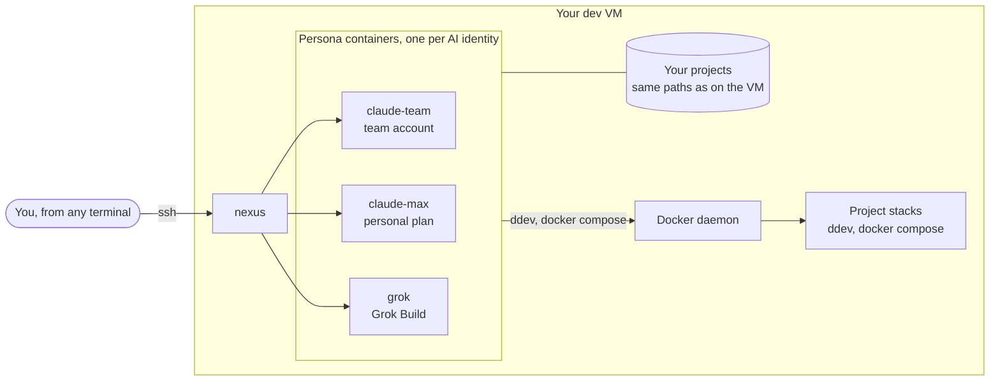
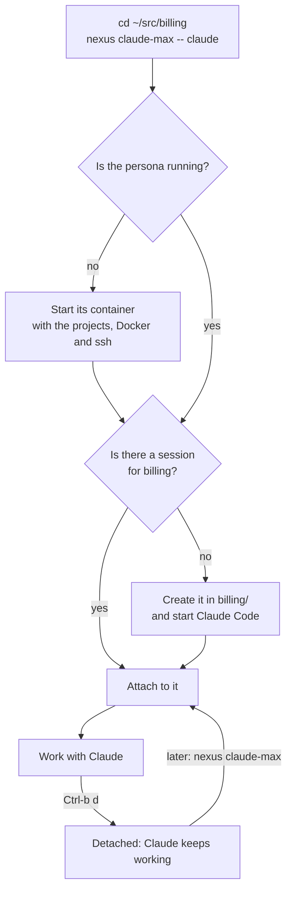
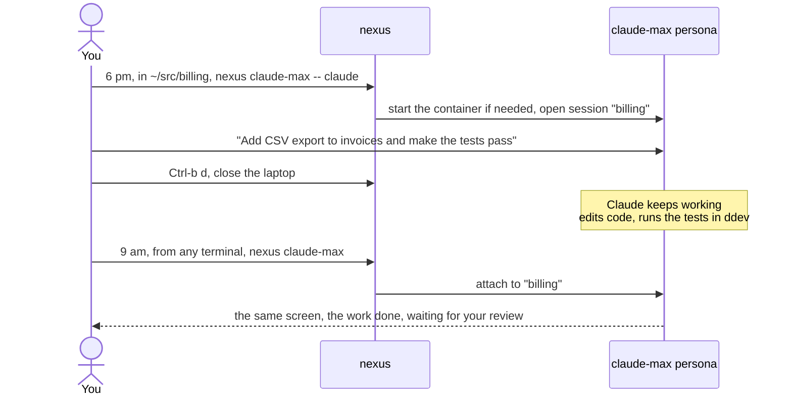
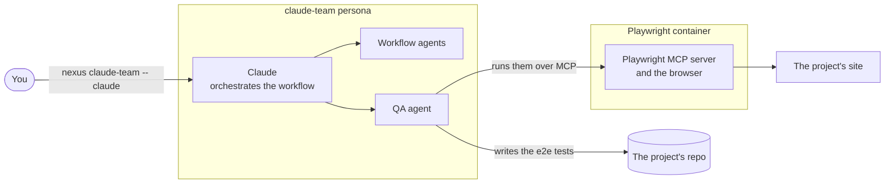
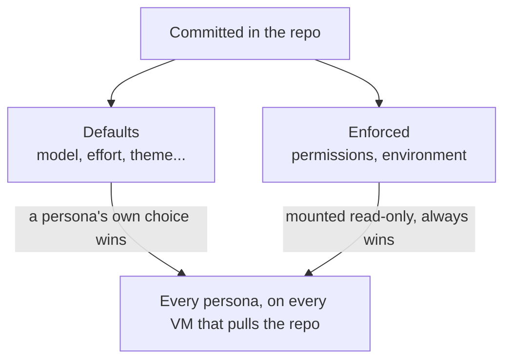
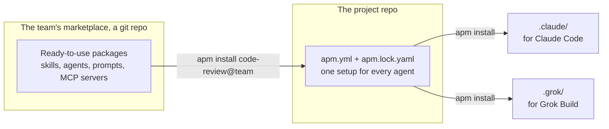

# Case study: Nexus, AI coding agents that live on your dev VM

> **In one line:** Nexus gives each AI coding agent you use its own always-on workspace on your dev VM. You hand
> it a task and walk away, and when you come back the work is done, in the right project, under the right
> account, on your real stack.

## The problem

AI coding agents such as Claude Code and Grok Build are good at real work. Where they run is the weak spot:

- **They're tied to a terminal.** If you close the laptop or lose wifi, the session is gone, half done.
- **One identity does everything.** Every agent commits as you and uses your tokens and ssh keys. And Claude Code
  holds one account at a time, so your team account and your personal plan take turns, or you juggle config
  directories by hand.
- **They can't reach the real stack**, or they reach it as you, with your keys and your whole machine.
- **Every VM drifts.** Each developer installs, configures and upgrades the CLIs a little differently.
- **Nobody sees the whole picture.** How many agents are running, on what, and how close are they to their limits?

## The idea: personas

A **persona** is one AI agent identity, for example `claude-team` (the team's Claude account), `claude-max`
(a personal plan) or `grok`. Each persona gets **its own long-lived container** on the dev VM. Inside it, each
project you work on is a tmux session, and it keeps running whether you're connected or not.



Three things make it feel native:

1. **The same paths and the same Docker.** Projects are mounted at the same path as on the VM, and each persona
   uses the VM's Docker daemon. So `ddev` and `docker compose` behave inside the persona exactly as they do outside.
2. **Its own everything.** Each persona has its own login, git author, GitHub token and home directory, and its
   own colour in the status bar.
3. **One command.** Run `nexus <persona>` in any project directory to open that project's session, or get back into it.

## How it works, in three moves

| Move | Command | What you get |
|---|---|---|
| Set up once per VM | `./nexus --config` | The settings every persona shares and a first persona, then a menu to add, change or remove personas (or `--yes` in scripts). Each step is saved only once it checks out, and a persona's image is built as it is added |
| Work | `nexus claude-max -- claude` | Claude Code in this project's own session. `Ctrl-b d` leaves it running |
| Watch | `nexus top` | A live view: CPU and memory for each persona, and for each session the model, context used, plan limits and cost |



## Happy use cases

### 1. Hand it off at 6 pm, review it at 9 am



### 2. Claude orchestrates, a QA agent tests in the browser

In the `claude-team` persona, Claude orchestrates workflows: it splits a job into steps and runs agents for them.
Alongside it, the Playwright plugin for Claude runs in a container of its own on the same VM. The plugin's QA agent
writes the end-to-end tests, then runs them through Playwright's MCP server.



Nexus makes this practical in four ways:

- A long workflow keeps going after you detach.
- The browsers live in their own container, so the persona image stays lean.
- It all runs on the team's account.
- `nexus top` shows how much context and plan limit the run is using.

### 3. Two agents on one project

Say you want a second opinion. `claude-team` writes the feature in the `billing` session. In another terminal,
`nexus grok -- grok` opens the same project in the grok persona, which reviews the diff. Each one works under its
own account and git author, so `git log` always shows who did what. Each also has its own status-bar colour, so you
never type into the wrong one.

### 4. The agent runs the real stack

In a ddev project, the agent runs `ddev start` itself, runs the test suite and reads the logs. It uses the same
database containers you would, and `https://*.ddev.site` is trusted inside. Nothing project-specific is installed in
the agent's image: the agent drives the project's own containers, so it fits any stack, PHP or Go alike.

### 5. One prompt from a script

```bash
git diff | nexus claude-team headless "review this diff" --output-format json
```

This runs without tmux or a session. The answer goes to stdout and the exit code is the CLI's, so it fits into a
git hook, a cron job or a pipeline. Ctrl-C stops the run inside the container too.

### 6. A new Claude Code release on every persona

`nexus claude-team upgrade` finds the newest version, pins it, builds the image and checks it. Once you confirm, it
recreates every Claude persona on the new image. Logins, settings and history live in each persona's own volume, so
they survive the upgrade. If something fails, the old version pin goes back.

### 7. A new VM, the same agents

To set up a new VM, clone the repo and run `./nexus --config`. The settings every persona should share are committed in
the repo, so every VM that pulls it gets the same ones:



## Agent packages: one setup for every agent

Skills, agents, prompts, rules and MCP servers make an AI agent good at *your* project. Normally each tool keeps
them in its own folder: `.claude/` for Claude Code, `.grok/` for Grok Build. So the same content gets written
twice, in two formats, and rewritten whenever you change tools.

Every persona comes with **APM**, Microsoft's Agent Package Manager. It is built into the image with its
self-update switched off, so it changes only when the image does. With APM, a project describes its agent setup once:



- **One file for any agent.** The project commits `apm.yml` (what it uses) and `apm.lock.yaml` (the exact
  versions). `apm install` turns them into the folders each tool expects: `.claude/`, `.grok/` or both, as listed in
  `apm.yml`. Nobody edits those folders by hand. To try another agent CLI, you add it to that list, and the skills,
  agents, prompts and rules follow it.
- **Ready-to-use packages from your own marketplace.** The team keeps its packages in a marketplace: a git repo on
  GitHub, GitLab or a git server of your own. You register it once per persona, then add packages by name, for
  example `apm install code-review@team`. The project's files record where each package came from, so a teammate
  or another persona just runs `apm install`, without registering. A private marketplace and its packages' repos
  need read access from the persona, such as its GitHub token.
- **The same result everywhere.** The lock pins every package to an exact commit, so a fresh clone gets exactly
  the same setup with `apm install --frozen`. In CI, `apm audit --ci` fails the build when a file in the generated
  folders was edited by hand, or when a prompt hides invisible characters, a trick for slipping in instructions.
  Once a persona has the packages cached, installing works offline too.

In practice:

- A new teammate or a new VM gets the project's agent packages with one command.
- You improve a package once, in one place, and `apm outdated` shows which projects are behind.

Limits, as of APM 0.33.0:

- Hooks (scripts that run on agent events) and MCP servers reach Claude Code only. For Grok Build, APM writes the
  skills, agents, prompts and rules.
- Settings such as permissions aren't part of it. In Nexus, those come from the shared settings files (use case 7).
- A GitHub-hosted marketplace used without a token runs into GitHub's limit of 60 requests an hour, so give each
  persona a `GH_TOKEN`.

## Benefits

| | Before | With Nexus |
|---|---|---|
| **Continuity** | The session dies with the terminal | Agents keep working while you're away, and you reattach from any terminal |
| **Identity** | One login and git author for every agent | One persona per account, each with its own login, git author and token |
| **Real environment** | The agent can't reach the stack, or reaches it as you | The same Docker, network and paths as the VM: ddev and compose just work |
| **Consistency** | Every VM set up by hand, each a little differently | One repo, one setup script, shared settings, pinned versions |
| **Agent setup** | Hand-kept `.claude/` and `.grok/` folders, one set per tool | One shared setup for every agent, with packages from the team's marketplace, the same on every clone |
| **Upgrades** | Self-updaters change things under you | Pinned versions and one-command upgrades, with nothing lost |
| **Oversight** | You guess what's running | `nexus ls` and `nexus top` show every persona and session, with limits and cost |
| **Choice** | One vendor | Claude Code and Grok Build side by side, in the same workflow |

## Honest guardrails

Nexus contains agents sensibly, but it isn't a sandbox, and it says so.

- **By default, your ssh keys stay outside.** A persona borrows your ssh-agent through a socket and never sees the
  key itself. Alternatively, a persona can have a deploy key of its own, or no ssh at all, in which case it commits
  and you push.
- **Each persona has limits** on CPU, memory and processes, and no privilege escalation inside.
- **The VM is the boundary.** A persona can drive the VM's Docker, and that amounts to root on the VM. So: use dev
  VMs only, keep production secrets off them, and take a snapshot before long unattended runs.
- **As shipped, agents run their tools without asking** (Claude in `bypassPermissions`, grok in `always-approve`).
  Changing that is one line in a committed file.

## Built to be trusted

- **Python's standard library and Docker Compose**, so there's nothing extra to install on the VM (Python 3.8 or
  newer, as Ubuntu 20.04 has).
- **Tested end to end.** The test suite creates throwaway personas against a stand-in API, then checks setup,
  attach and detach, headless runs, the ssh modes, the shared settings and the live view. When a bug turns up on a
  real machine, it becomes a test.
- **Fails safe.** `nexus --config` won't write half a change. `nexus` refuses to start a persona whose files are
  out of date, and says what to run.
